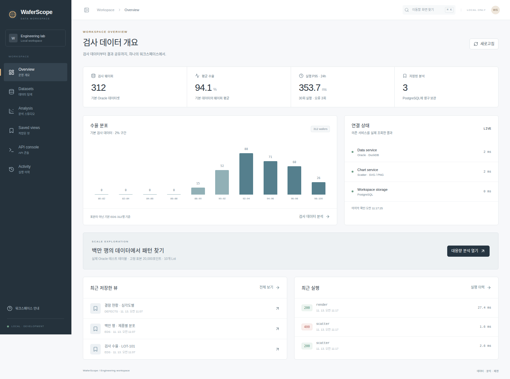
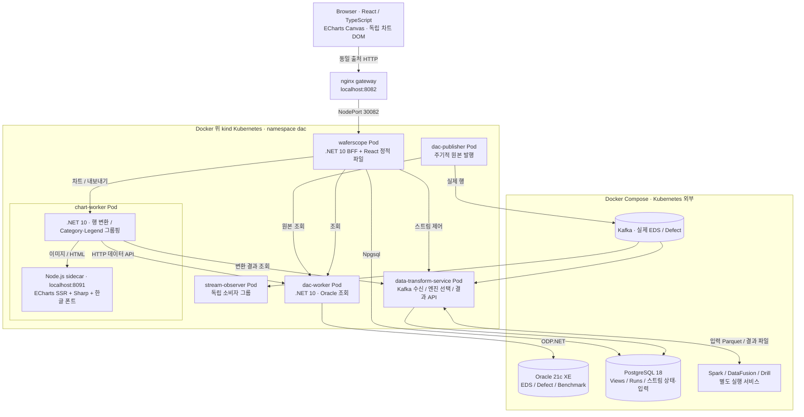
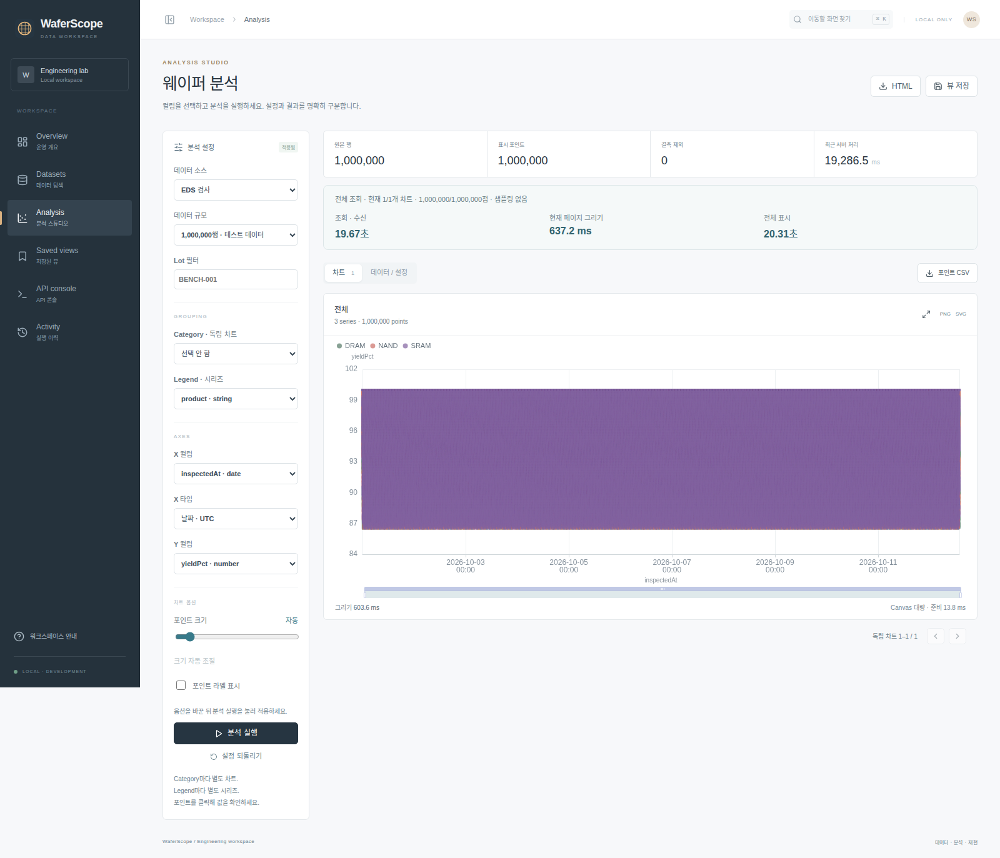

# WaferScope · Multi-engine Data Workbench

**Oracle의 반도체 검사 데이터를 조회하고, DuckDB·Spark·DataFusion·Drill로 결합·필터링하고, 독립된 산점도로 탐색하는 통합 분석 애플리케이션입니다.**

.NET 10 조회·발행·변환·수신 검증·차트·포털 서비스와 React UI를 Kubernetes에 배포합니다. 분석 설정과 실행 이력은 PostgreSQL에 저장하며, 웹 차트와 PNG·SVG·독립 HTML 내보내기를 지원합니다. 1천·1만·10만·100만 건을 선택해 **샘플링 없이 전체 데이터**를 처리할 수 있습니다.

[분석 엔진 선택](docs/engines.md) · [Kafka 스트리밍](docs/streaming.md) · [시스템 설계](docs/architecture.md) · [실행·운영](docs/runbook.md) · [API 명세](docs/api.md) · [성능 측정](docs/chart-timing.md) · [데모 가이드](docs/portfolio-guide.md)



## 해결하려는 문제

검사 결과와 결함 이력이 서로 다른 API에 있을 때 분석자는 데이터를 내려받아 수동으로 합치고, 차트마다 축·그룹 조건을 다시 지정해야 합니다. WaferScope는 원본 조회, 변환, 시각화, 설정 저장, 재실행을 하나의 작업 공간에 연결합니다.

- **Category**로 고른 컬럼의 값마다 별도 DOM과 차트 인스턴스를 만듭니다.
- **Legend**로 고른 컬럼의 값마다 각 차트 안에 독립 시리즈를 만듭니다.
- X축은 날짜·숫자·문자열, Y축은 숫자입니다. 기본 X축은 UTC 검사 날짜입니다.
- 원본 건수, 유효 포인트 수, 결측 제외 수, 실제 화면에 그린 점 수를 구분합니다.
- 서버가 특정 차트 라이브러리의 option 대신 중립적인 `ScatterSpec`을 반환합니다.

모든 샘플은 합성 데이터입니다. 실제 반도체 회사의 데이터나 연동을 포함하지 않습니다.

## 주요 기능

| 화면 / 기능 | 구현 내용 |
| --- | --- |
| Overview | 데이터 통계, 수율 분포, 의존 서비스 상태, 최근 24시간 실행 P95 |
| Datasets | EDS·결함 조회, Lot 필터, 검색·정렬·페이지 이동, CSV |
| Analysis | Category/Legend 선택, 날짜·숫자·문자열 X, 숫자 Y, 줌·포인트 조회·확대, 요청 취소 |
| 차트 옵션 | 포인트 크기, 컬럼 기반 라벨, 라벨 글자 크기, 겹침 방지 |
| 성능 표시 | 조회·수신 / 현재 페이지 그리기 / 전체 표시 시간, 차트별 처리 시간 |
| Engine selection | DuckDB / Spark / DataFusion / Drill 실제 실행, 동일 원본 재분석, 단계별 시간 |
| Data streams | Kafka 실제 원본 발행, 두 소비자 그룹, 전체 DuckDB 변환, 시작·중지, 수신 상세, 결과 차트 |
| Saved views | 설정·메모 저장, 고정, 검색, 직접 링크, 버전 기반 충돌 감지 |
| API console | 고정 요청 프리셋, JSON 편집, 응답 표/JSON, 상태·실행 시간 |
| Activity | 실행 성공·실패 이력, 요청 설정, 재실행, 상태 필터 |
| Export | 원본/포인트 CSV, 서버 렌더링 PNG·SVG, 오프라인 HTML |
| 대용량 | Oracle 별도 테이블의 실제 합성 100만 행, 선택 범위 전체 처리 |

## 시스템 구성



Oracle과 PostgreSQL은 클러스터 밖의 Compose 컨테이너와 영속 볼륨을 사용합니다. `chart-worker`는 Oracle에 직접 접속하지 않고 DAC의 HTTP API를 호출합니다. DuckDB는 별도 `data-transform-service` Pod 안에서 실행합니다. Kafka 원본 토픽을 변환 서비스와 수신 검증 서비스가 서로 다른 consumer group으로 읽습니다. [스트리밍 흐름과 저장·재처리 계약](docs/streaming.md)을 참고하세요.

**상세 다이어그램:** [배포·요청 시퀀스·ER 모델·오류 처리](docs/architecture.md). 다이어그램 원본은 [docs/diagrams](docs/diagrams)에 있습니다.

## 빠른 시작

검증 환경은 **Linux x86-64 + Docker Engine + Docker Compose + kind + kubectl + Python 3**입니다. `kind`/`kubectl`은 PATH 또는 `~/.local/bin`에 있어야 합니다. 현재 Docker 사용자가 `docker info`를 실행할 수 있어야 합니다. Oracle XE 컨테이너 및 대량 렌더링을 고려해 전체 엔진 구성은 메모리 32GB 이상과 충분한 디스크를 권장합니다. ARM/macOS 조합은 검증하지 않았습니다.

```bash
git clone https://github.com/amuro33/dac-duckdb.git
cd dac-duckdb
./scripts/up.sh
```

`up.sh`가 순서대로 수행하는 작업:

1. `.env`가 없으면 무작위 DB 비밀번호를 생성합니다. 기존 파일은 보존합니다.
2. Oracle/PostgreSQL 컨테이너를 시작하고 readiness를 기다립니다.
3. `dac` kind 클러스터 생성 및 DB 네트워크 연결을 확인합니다.
4. 기본 EDS 312행·결함 464행과 별도 benchmark 100만 행을 준비합니다.
5. Spark master·worker 2개, DataFusion adapter, Drillbit과 Kafka를 시작하고 DAC·Publisher·Transform·Observer·Chart API/renderer·Portal을 배포합니다.
6. 예제 분석 뷰를 PostgreSQL에 등록합니다.

첫 실행은 이미지 다운로드와 Oracle 초기화 때문에 시간이 걸립니다. .NET SDK와 프런트 빌드 도구는 Docker 빌드 단계에서 사용하므로 실행만 할 때 호스트에 설치할 필요가 없습니다. `.env.example`은 설정 설명용이며 실제 비밀번호는 Git에 포함하지 않습니다.

| 서비스 | 주소 |
| --- | --- |
| **통합 애플리케이션** | **http://localhost:8082** |
| 기존 DAC 진단 콘솔 | http://localhost:8080 |
| 기존 Chart Lab | http://localhost:8081 |
| Oracle | `127.0.0.1:1521/XEPDB1` · 사용자 `app` |
| PostgreSQL | `127.0.0.1:5432/appdb` · 사용자 `app` |

다른 기기에서 접속하려면 `.env`의 `WAFERSCOPE_BIND_ADDRESS=0.0.0.0`을 설정하고 `docker compose -f compose.portal.yaml up -d`를 실행합니다. 브라우저에서는 `http://<서버의 LAN IP>:8082`를 사용합니다. 기본값은 `127.0.0.1`입니다. 현재 앱에는 사용자 인증이 없으므로 신뢰하는 개발 네트워크 범위로 운영합니다.

## 5분 데모

1. **Overview**에서 Oracle·Chart·PostgreSQL 상태를 확인합니다.
2. **Datasets**에서 EDS/결함을 조회하고 **API console**의 join/merge/filter 프리셋을 실행합니다.
3. **Analysis**에서 EDS, 10만 행, Category=`lotId`, Legend=`product`, X=`inspectedAt`, Y=`yieldPct`를 적용합니다.
4. 10개 카테고리가 별도 차트로 나뉘는지 확인하고 다음 페이지로 이동합니다.
5. 포인트 크기를 바꿔 실행합니다. 데이터 재조회 없이 갱신되며 실제 표시 시간이 기록됩니다.
6. 라벨 컬럼을 선택하고 PNG/SVG를 저장합니다. 뷰를 저장한 뒤 다시 열어 설정 복원을 확인합니다.
7. **Data streams**에서 원본 규모와 주기를 정해 발행하고, 두 소비자의 수신 건수와 DuckDB 결과를 확인합니다. 완료된 결과는 `차트 열기`로 분석합니다.
8. Analysis의 원본 소스를 `EDS 검사`, Category를 `선택 안 함`, 규모를 100만으로 지정해 한 차트에 전체 점을 그려 봅니다.



**엔진 비교:** Analysis에서 `EDS × Defect`를 선택하면 변환 엔진을 고를 수 있습니다. 결과가 준비된 후 엔진을 바꾸면 동일 원본을 재분석합니다. Spark는 현재 물리 서버 한 대의 워커 컨테이너 두 개이며, 실제 여러 머신에 걸친 성능 향상을 측정한 구성은 아닙니다. [구조·저장 계약·검증 결과](docs/engines.md).

## 데이터 처리의 정확한 의미

| 항목 | 실제 동작 |
| --- | --- |
| DuckDB `join` | `lot_id + wafer_id` 복합 키의 inner/left/full 조인 |
| DuckDB `merge` | 공통 스키마로 맞춘 `UNION ALL` 세로 결합. SQL upsert가 아님 |
| DuckDB `filter` | 조인 결과에 최소 수율·심각도 AND 조건 적용 |
| Kafka | 실제 EDS/결함 행을 최대 1천 행씩 발행. 작업 ID만 전달하는 구조가 아님 |
| `source=transformed` | Kafka로 받은 두 원본의 실제 DuckDB 결과를 datasetId로 재사용 |
| Category/Legend 그룹핑 | Chart.Worker의 .NET Dictionary. 현재 DuckDB 그룹핑 아님 |
| `sampleSize` | 호환을 위해 유지한 필드명. 선택 N행 전체를 뜻하며 표본 추출 아님 |
| 내부 1만 행 페이지 | 끝까지 읽고 합치는 전송 단위. 표시 점 수를 줄이지 않음 |
| `sampledOutRows` / `sampling` | 항상 `0` / `none` |
| 카테고리 화면 페이지 | 한 번에 4개 차트를 표시. 각 카테고리의 모든 점은 유지 |
| 기존 동기 API 한도 | 기본 데이터 호환 경로는 소스당 1천 행 경계에서 잘린 결과를 거부. Kafka benchmark 경로는 전체 입력을 계산 |
| benchmark `joined` | 합성 테이블의 대응 필드 투영. 100만 행 DuckDB 조인 성능 주장이 아님 |

워크플로우 엔진은 구현하지 않았습니다. [workflow-request.json](examples/workflow-request.json)과 요청 프리셋을 외부 워크플로우가 보낸 명세로 간주합니다.

## 측정된 성능

2026-11-13, 동일 머신의 headless Chromium/SwiftShader에서 각 조건을 한 번씩 측정한 값입니다. 장치·브라우저·포인트 크기·라벨 옵션에 따라 달라지며 SLA나 부하 테스트 결과가 아닙니다.

| 조건 | 조회·수신 | 그리기 | 전체 표시 |
| --- | ---: | ---: | ---: |
| 10만 행 / 현재 4개 차트 4만 점 | 926.4ms | 50.3ms | 976.7ms |
| 100만 행 / 현재 4개 차트 40만 점 | 20.42초 | 241.1ms | 20.66초 |
| 100만 행 / 한 차트 100만 점 | 19.67초 | 637.2ms | 20.31초 |

100만 행 조회 후 포인트 크기 변경은 **20.96초 → 0.81초**로 줄었습니다. 데이터 재조회와 차트 인스턴스 재생성을 제거한 효과이며 최초 조회 시간은 여전히 약 20초입니다. 숫자/날짜 좌표는 Float64Array로 전달하고, 라벨 없는 대량 차트는 Canvas large/progressive 경로를 사용합니다. 점을 생략하거나 집계하지 않습니다.

[측정 방법과 한계](docs/chart-timing.md) · [공개 측정 원본 JSON](docs/evidence) · [GPU/CUDA 검토](docs/gpu-optimization-review.md)

## 테스트

```bash
# Docker .NET SDK로 유닛/API/스트림 계약 테스트
./scripts/test.sh

# 프런트 테스트와 production build: Node.js 22.12+ 필요
npm ci --prefix src/Portal.Web
npm test --prefix src/Portal.Web
npm run build --prefix src/Portal.Web

# 실행 중인 실제 DB와 서비스에 대한 검증
python3 scripts/portal-integration.py
python3 scripts/benchmark-integration.py
python3 scripts/full-data-export-check.py
python3 scripts/streaming-integration.py   # 실제 Kafka, 두 소비자, 중복·장애 복구, 전체 결과 검증
python3 scripts/engines-integration.py     # 네 엔진 × 네 규모, 전체 결과·NULL·중복·빈 입력 비교
```

브라우저 검증용 Playwright는 별도 도구 디렉터리에 설치할 수 있습니다.

```bash
npm install --prefix /tmp/waferscope-browser playwright
/tmp/waferscope-browser/node_modules/.bin/playwright install chromium
export PLAYWRIGHT_MODULE=/tmp/waferscope-browser/node_modules/playwright
node scripts/chart-timing-browser.cjs
node scripts/chart-million-single.cjs
node scripts/chart-options-browser.cjs
node scripts/full-data-interaction.cjs
node scripts/streaming-browser.cjs
node scripts/engines-browser.cjs
```

현재 로컬 검증: **.NET 186개**, **프런트 유닛 28개**, **Kafka 통합 13항목·스트림 브라우저 9항목** 통과. 기존 경로 검증은 실제 데이터 검사 42항목, 시간 표시/옵션/대량 상호작용/단일 백만 점 브라우저 검사 21항목 통과. 상세 결과와 범위는 [전체 데이터 검증](docs/full-data-validation.md), [차트 시간 검증](docs/chart-timing.md)을 참고하세요. `artifacts/`는 실행 시 생성되며 Git에서 제외합니다. 통합 테스트는 실제 실행 이력을 추가하고, 뷰 생성 테스트는 자신이 만든 레코드를 정리합니다.

## 소스 구조

```text
src/
  Dac.Worker/       Oracle API · 호환 프록시 · 전체 데이터 페이징
  Dac.Contracts/    원본·변환 요청 공유 계약
  Data.Publisher/   실제 원본을 Kafka에 주기적으로 발행
  Data.Transform/   Kafka 수신 · 엔진 실행 조정 · Parquet 결과 API
  Analytics.Engines/ Spark / DataFusion / Drill 실행 어댑터
  Streaming.Core/   이벤트 계약 · 영속 수신 · Kafka 클라이언트
  Chart.Worker/     데이터 API 클라이언트 · 중립 차트 모델 · 그룹핑
  Chart.Renderer/   ECharts SSR · Sharp PNG · 독립 HTML
  Portal.Api/       BFF · endpoint allowlist · PostgreSQL 저장
  Portal.Web/       React 분석·스트림 UI · 웹 차트 · 렌더 시간 측정
tests/             .NET 서비스별 유닛/API 테스트
db/                초기 스키마 · 기본 샘플 · 100만 행 생성 SQL
k8s/               kind · Deployment/Service · nginx 설정
scripts/           실행 · 배포 · 시드 · 자동 검증
examples/          요청 JSON · Postman 컬렉션
docs/              설계 · 운영 · API · 측정 · 다이어그램
```

## 설계 결정과 현재 범위

- 조회·발행·변환·차트·포털을 분리하고 ECharts 의존성을 렌더러 경계에 모았습니다.
- 저장 뷰는 낙관적 동시성 제어로 수정 충돌을 409로 반환합니다.
- 페이지 누락·커서 역행·건수 불일치가 발생하면 부분 차트를 성공으로 반환하지 않습니다.
- BFF는 허용된 내부 경로만 실행하며 요청 크기·동시 실행 수를 제한합니다.
- 원본은 Oracle, 스트림 입력·상태·분석 설정은 PostgreSQL, 변환 결과는 Parquet PVC, 이벤트는 Kafka에 저장합니다.
- 단일 노드/단일 브로커의 로컬 개발 환경입니다. Kafka 보존 기간은 7일이며 입력·결과의 자동 정리 정책은 아직 없습니다. 인증·테넌트 격리·고가용성·자동 백업·분산 추적·워크플로우 엔진·CUDA 가속은 구현 범위에 포함하지 않습니다.

상세 근거와 확장 방향은 [설계 문서](docs/architecture.md)에 정리했습니다. 기존 ECharts 배포본의 라이선스는 [ECHARTS-LICENSE](src/Chart.Worker/wwwroot/vendor/ECHARTS-LICENSE)에 보존되어 있으며 각 의존성의 라이선스는 해당 패키지를 따릅니다.
