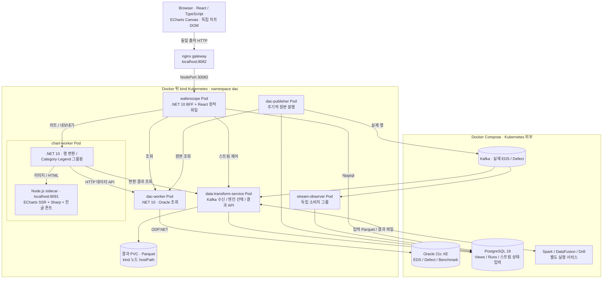
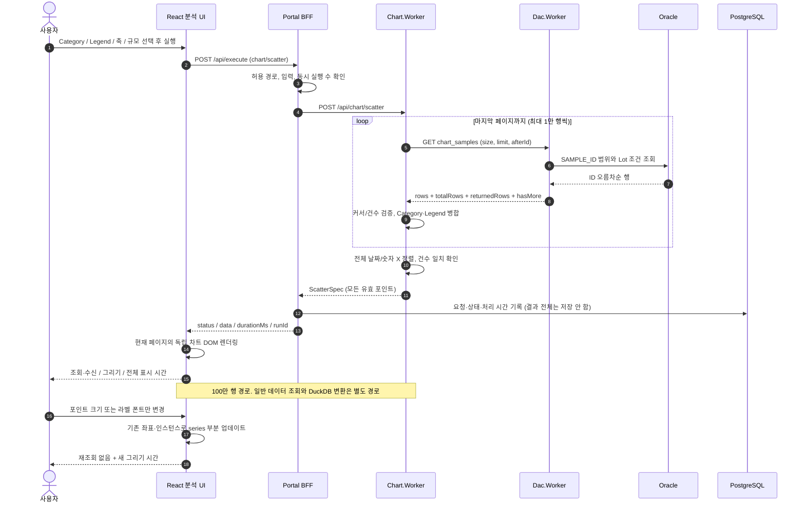
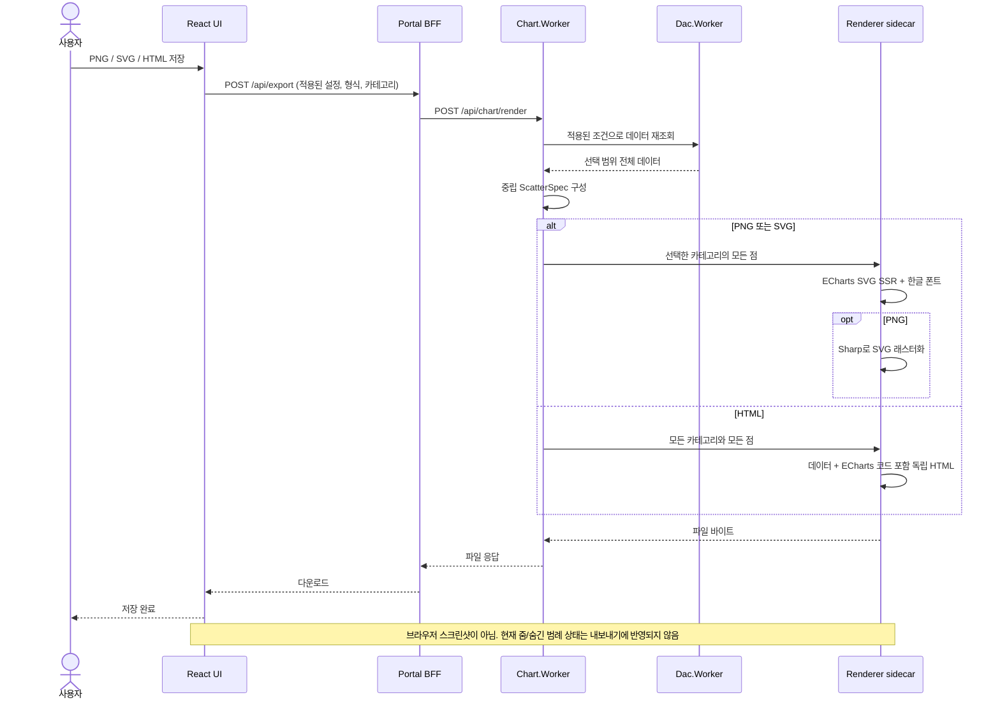
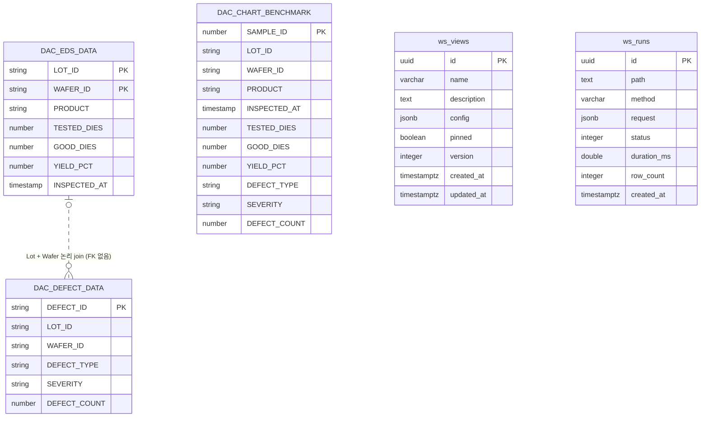

# 시스템 설계와 데이터 흐름

**분석 엔진 확장:** DuckDB·Spark·DataFusion·Drill 선택과 동일 원본 재분석을 지원합니다. 현재 구현·배포 경계는 [선택형 분석 엔진](engines.md)을 참고하세요.

**Kafka 확장 적용:** 원본 조회와 DuckDB 변환을 별도 Pod로 분리했습니다. 실제 행 발행·독립 소비자 그룹·영속 수신·Parquet 결과의 최신 구조는 [Kafka 스트리밍 설계](streaming.md)를 참고하세요. 아래 대용량 직접 조회 경로도 계속 지원합니다.

이 문서는 실행 중인 구현을 기준으로 작성했습니다. 아래 다이어그램에서 **Pod / 컨테이너 / DB 서버 / 인메모리 엔진**을 구분합니다. Mermaid 원본과 확대 가능한 SVG는 [diagrams](diagrams)에 있으며 아래 Mermaid 블록은 GitHub에서 직접 렌더링됩니다.

## 1. 배포 구조와 네트워크 경계



Oracle/PostgreSQL은 Kubernetes 외부의 Compose 서비스이며 kind 노드를 해당 Docker 네트워크에 연결합니다. renderer는 chart Pod 안의 sidecar이고 외부 Service를 따로 두지 않습니다.

| 보조 구성 | 연결 / 의미 |
| --- | --- |
| DAC 진단 콘솔 | localhost:8080 → NodePort 30080 |
| Chart Lab | localhost:8081 → nginx → NodePort 30081 |
| dac-oracle Secret | DAC 환경 변수에 연결 문자열 주입 |
| portal-postgres Secret | BFF·발행·변환·수신 검증 서비스에 연결 문자열 주입 |
| oracle-data / postgres-data | Compose named volume; Pod 재시작과 별개로 데이터 유지 |

## 2. 대용량 차트 요청 시퀀스



일반 EDS/결함은 기본 조회 API를, 일반 joined는 DuckDB transform을 사용합니다. 위 페이지 루프는 benchmark 규모를 선택한 경우입니다. 10K는 전송 단위이고 최종 차트의 최대 점 수가 아닙니다.

## 3. 이미지와 독립 HTML 내보내기



PNG/SVG는 선택한 한 카테고리 전체를, HTML은 모든 카테고리를 포함합니다. renderer 교체 시 중립 ScatterSpec 계약을 유지할 수 있습니다.

## 4. 영속 데이터 모델



앞의 세 테이블은 Oracle, ws_views/ws_runs는 PostgreSQL에 있습니다. EDS와 Defect 사이에는 **논리적 조인 관계만 있고 FK 제약은 없습니다**. EDS가 없는 결함도 테스트 데이터에 포함됩니다. benchmark는 독립 합성 데이터이며 기본 테이블을 복제한 FK 관계가 아닙니다. 저장 뷰와 실행 이력에도 별도 FK 관계는 없습니다.

## 5. 서비스별 구현과 설계 결정


## Service boundaries

The browser speaks only to the WaferScope BFF. Streaming control endpoints are allowlisted and routed to data-transform-service. Its API credentials and internal service addresses are never
sent to the browser. The BFF forwards only registered DAC/chart endpoints; arbitrary upstream hosts, methods,
and administration endpoints are rejected. Image exports have their own validated endpoint.

`dac-worker` owns Oracle data access. DuckDB now runs in `data-transform-service`. The compatibility endpoint forwards to that service, which performs join, vertical UNION ALL merge and filtering. The Kafka path consumes complete durable batches and writes reusable Parquet datasets; one million rows from each source were joined and all result IDs verified. Only the legacy synchronous compatibility path is bounded to 1,000 source rows and rejects a full-sized snapshot rather than silently joining truncated data.

`chart-worker` calls DAC for direct sources and data-transform-service for a persisted transformed dataset over HTTP and transforms rows into an ECharts-independent model:

```
ScatterSpec
  charts[category key]
    series[legend key]
      points[{x,y}]
```

Chart category/legend grouping currently uses nested .NET dictionaries. It preserves individual points,
type-qualified grouping keys, and null groups. Numeric/date X values are sorted; dates become UTC epoch
milliseconds. Null coordinates are counted as skipped rows. A future DuckDB chart grouping adapter could
replace this stage without changing the neutral response contract. No claim of that migration is made here.

The chart Pod contains an ECharts SSR sidecar. SVG is rendered server-side and rasterized with Sharp for PNG.
Fonts are installed in the renderer so image labels, including Korean, work without a browser font environment.
The integrated web renderer is a separate adapter and uses the same deterministic series colors. Web zoom,
point interaction, and layout remain client concerns; image exports represent the full applied configuration,
not the current client zoom rectangle or hidden legend state.

## Scale-mode semantics — no sampling

Oracle `DAC_CHART_BENCHMARK` contains 1,000,000 synthetic inspection/defect pairs. Choosing N selects IDs <= N,
then applies the Lot filter. All matching rows are read in ID order. The former ORA_HASH ordering and 20K cap are removed.

The raw DAC endpoint returns all matching rows by default using asynchronous serialization. Explicit `limit` and `afterId`
provide keyset pagination; a page is not a statistical sample. Chart-worker follows successive 10K-row pages to the exact total,
converts each page into points, merges every category/series, and sorts complete numeric/date series globally. Missing pages,
non-advancing cursors and row-count mismatches fail the request rather than returning a partial chart.

- All four sizes (1K, 10K, 100K, 1M) are fully processed.
- `sourceRows = plottedRows + skippedRows`; invalid/null X/Y rows are counted as skipped.
- Compatibility fields `sampledOutRows` and `sampling` remain `0` and `none`.
- Metadata inspection reads only 100 rows for column types; it does not limit the analysis data.
- Category count remains limited to 50 and series to 50 per category; overflow is an explicit error.
- Synthetic `joined` projects paired fields from the benchmark table; normal DuckDB transforms still have a separate 1K snapshot bound.

Browser chart cards are paginated four at a time, but each card contains every point in its category. For more than 20K total
points with labels OFF, the Canvas large rendering path batches drawing without dropping rows. Labels ON uses the normal renderer.
Image export passes the selected complete category to the renderer; HTML export contains all categories. Very large labels and
exports can take substantial time/memory. Upstream timeouts and container resources were increased for full datasets; errors are
reported instead of substituting a sample. The benchmark table is treated as immutable during pagination; this is not an Oracle
cross-request snapshot for concurrent edits that preserve row counts.

## Durable workspace state

PostgreSQL `ws_views` stores UUID, name, notes, JSONB chart configuration, pin state, version and timestamps.
Updates and deletion include the expected version in their SQL predicates. A stale version returns 409,
preventing a second tab from silently overwriting a more recent change. Example views are inserted only if
absent and are labeled as examples.

`ws_runs` stores completed user-initiated request paths, methods, request JSON, status, elapsed time, row count,
and creation time. Large response datasets are not stored. Metadata polling is not recorded. Cancelled requests
may never reach the persistence stage. The last 200 runs are exposed to the UI; 24-hour count/error/P95 metrics
are computed from the actual database. There is no automatic retention job in this local version.

## UI state and accessibility

Analysis maintains separate draft and applied configurations. A dirty banner prevents silently attributing an
old plot to new settings. Saving and exporting use the applied configuration. Fetches are cancellable and
unmounted effects abort their requests. ECharts instances and ResizeObservers are disposed on unmount.

The app includes keyboard command navigation, labeled form controls, visible focus styles, modal focus trapping,
Escape handling, responsive layouts, reduced-motion support, error/empty/loading states, and point summaries.
Charts are independently owned DOM instances. CSV exports quote values and neutralize leading formula characters.

## Operational boundaries

The system uses single replicas on a local kind cluster and nginx gateways. Portal 8082 defaults to loopback; LAN access can be enabled with
`WAFERSCOPE_BIND_ADDRESS=0.0.0.0`; database and diagnostic console ports remain loopback-bound. Database volumes persist across
container recreation. This version has no user authentication, tenant isolation, HA, TLS termination, automatic
backup schedule, migration framework for future schema revisions, or centralized metrics collector.

There is a 64KB portal request body limit, a bounded concurrency limiter for execution/export (2 running, 8 queued),
a 240-second BFF upstream HTTP timeout, origin checks on browser mutations, CSP, security headers, and non-root Pods.
These controls do not turn the local application into a secure public multi-user service. Production exposure
requires an explicit identity model and network/secret/backup design.

## Date-first analysis

The web analysis defaults to `inspectedAt` (`inspected_at` for joined data), including source/size changes
and built-in example views. Explicit string/number axes remain selectable. Date tick labels include year,
month, day and time in UTC in both web charts and exported images. Base defect rows expose the related
wafer's EDS inspection timestamp through a left join; this is not a separately measured defect detection
time. Unmatched defects retain a null timestamp. DuckDB join/merge retain the inspection timestamp.

## Point and label appearance

Optional chart request fields are `pointSize` (null for automatic, otherwise 2–20 px), `showLabels` (default false),
`labelColumn` (null uses Y), and `labelFontSize` (8–20 px, default 11). The same options are stored in saved views
and returned in the neutral scatter specification for web/SSR adapters. Existing saved configurations remain valid.
Labels are resolved from scalar source columns before point sorting; null values produce no text, and long labels
are limited to 120 characters. Label strings are omitted from the response when labels are disabled.

Both adapters hide overlapping labels. This does not guarantee every point has a visible label. Web charts use
progressive drawing with labels off; labels use complete layout for correct overlap handling. Initial ResizeObserver
notifications no longer trigger a duplicate full layout when dimensions are unchanged. Native resize still updates the chart.
API and persisted configuration validation reject invalid numeric ranges and field types.

The ECharts adapter follows the official [scatter symbol-size](https://echarts.apache.org/handbook/en/how-to/chart-types/scatter/basic-scatter/)
and [label options](https://echarts.apache.org/handbook/en/how-to/label/rich-text/) contracts. Label overlap layout is explicitly registered
in the modular web bundle. The UI preserves draft/applied state semantics. Point-size/font-only changes reuse data and patch the existing chart instances; source, grouping, axis and label-data changes trigger a fresh request. See [render timing](chart-timing.md).

## 6. 불변 조건과 오류 처리

| 경계 | 보장 / 실패 처리 | 구현 위치 |
| --- | --- | --- |
| BFF 실행 | 허용 경로·메서드만 요청, body 64KB, 실행/내보내기 동시 2개·대기 8개 | `Portal.Api/Program.cs`, `Contracts.cs` |
| 전체 데이터 | 커서 진행, totalRows 안정성, 최종 건수 일치 검증. 불완전 결과는 실패 | `Chart.Worker/DataApiClient.cs` |
| 그룹핑 | 타입을 포함한 키, NULL 그룹 구분, 중복 포인트 유지, 숫자/날짜 전역 정렬 | `Chart.Worker/ChartBuilder.cs` |
| 차트 건수 | sourceRows = plottedRows + skippedRows, sampledOutRows = 0 | `Chart.Worker/ChartBuilder.cs` |
| 그룹 수 | Category 최대 50, Category당 Legend 최대 50. 초과는 입력 오류 | `Chart.Worker/ChartBuilder.cs` |
| 기본 DuckDB 변환 | 소스가 1천 행 경계에 닿으면 잘린 snapshot을 결합하지 않고 거부 | `Data.Transform/ApiDatasetSource.cs` |
| 저장 뷰 | UPDATE/DELETE의 expected version 불일치는 409 | `Portal.Api/Store.cs` |
| 브라우저 측정 | 현재 batch에 속하는 현재 페이지 차트만 집계, 실패를 성공 시간으로 표시하지 않음 | `Portal.Web/src/chartPerformance.ts` |

## 7. 확장 우선순위

1. 최초 조회의 Oracle 처리 / 내부 HTTP 페이지 왕복 / JSON 직렬화·해석을 분리 계측합니다. 현재 총 지연의 대부분이 이 구간입니다.
2. 전체 데이터 의미를 유지하면서 바이너리 전송 또는 스트리밍 점진 표시를 검토합니다. 중간 실패와 최종 완전성 검증을 함께 설계해야 합니다.
3. 사용자 인증·권한·테넌트와 저장 데이터의 소유권을 정의한 후 외부 서비스를 설계합니다.
4. OpenTelemetry 추적, 요청 ID 전파, DB 마이그레이션, 이력 보존 정책, 백업 복구 검증을 추가합니다.
5. 실제 워크플로우 서비스를 넣을 경우 현재 transform 요청 계약 위에 작업 상태·재시도·멱등성·취소를 설계합니다.

이 목록은 향후 작업이며 현재 구현된 기능으로 표시하지 않습니다.

## 8. DuckDB와 Kafka는 어떤 차이가 있는가

| 관점 | DuckDB | Kafka |
| --- | --- | --- |
| 핵심 역할 | 데이터를 SQL로 조회·조인·필터·집계하는 분석 엔진 | 이벤트를 수신·보관하고 여러 소비자에게 전달하는 로그 기반 시스템 |
| 현재 앱에 대입 | 별도 변환 서비스에서 EDS/결함을 조인·필터링 | 실제 원본 행을 두 독립 소비자 그룹에 지속 전달 |
| 처리 단위 | 요청 시 확보한 테이블/데이터셋 | 시간에 따라 계속 들어오는 이벤트 스트림 |
| 조인 | SQL JOIN으로 두 테이블 연결 | Kafka 자체 대신 Kafka Streams/Flink 등의 처리 계층에서 구성 |
| 주요 설계 고려 | 데이터 크기, 쿼리 비용, 메모리, snapshot 일관성 | 파티션 키, 순서, 소비 위치, 재처리, 중복·지연 이벤트 |

DuckDB는 계산을 담당하고 Kafka는 실제 원본 행을 전달합니다. 요청형 직접 분석과 주기적 Kafka 분석을 함께 지원합니다. Kafka를 실제로 도입했으며 [스트리밍 배포도](streaming.md)에 현재 구현을 표시했습니다. Kafka가 전달·보존을 담당하고 DuckDB가 데이터셋의 계산을 담당합니다.

예를 들어 검사기 → Kafka → 저장 소비자/이상 탐지 소비자/대시보드 소비자로 확장할 수 있습니다. 두 스트림을 조인하려면 Lot+Wafer 키뿐 아니라 이벤트 시간, 허용 대기 구간, 늦게 도착한 데이터, 재처리 시 중복 반영 방식을 정의해야 합니다. 현재 구현은 완전성이 검증된 유한한 스냅샷을 조인합니다. 이벤트 시간 기반의 무한 스트림 조인은 별도 설계 범위입니다.
