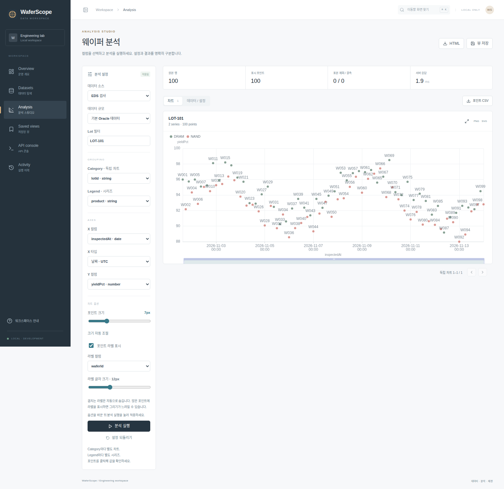

# 포인트·라벨 옵션과 성능

> 이 문서의 기존 2만 점 측정은 샘플링 제거 전의 기록입니다. 현재는 선택한 건수 전체를 처리합니다.
> 현재 동작과 검증은 [전체 데이터 처리](full-data-validation.md)를 참조하세요.


## 사용 방법

분석 화면 왼쪽의 **차트 옵션**을 변경한 뒤 **분석 실행**을 누릅니다.

- 포인트 크기: 자동 또는 2–20px, 0.5px 간격. 자동은 전체 표시 점 수 5천 초과 시 3.5px, 그 외 6px입니다.
- 포인트 라벨 표시: 기본 OFF. 기본 텍스트는 Y값이며 다른 원본 컬럼을 선택할 수 있습니다.
- 라벨 글자 크기: 8–20px. 겹치는 라벨은 자동으로 숨깁니다.
- 옵션은 분석 저장·직접 링크·새로고침·PNG/SVG/HTML 내보내기에 함께 적용됩니다.
- 라벨이 null이면 해당 텍스트만 생략하며 포인트는 남깁니다. 텍스트는 최대 120자로 제한합니다.



## 측정 조건

2026-11-13 로컬 AMD Ryzen 9 5950X(32 논리 CPU), Chromium 158.0.8127.18,
1600×1100 viewport. Oracle/BFF/worker는 기존 Docker/kind 환경입니다.
추가 GPU 점검에서 이 headless 브라우저는 ANGLE/SwiftShader 및 소프트웨어 Canvas 경로임을 확인했습니다.
아래 수치는 하드웨어 GPU 가속 결과가 아니며 실제 사용자의 브라우저와 다를 수 있습니다.

각 데이터 규모에서 라벨 OFF/ON을 각각 3회 순차 측정한 중앙값입니다.
별도 동시 부하는 주지 않았으며 워밍된 서비스에서 실행했습니다.

비교 조건은 동일합니다: 검사 날짜 X, 수율 Y, category 없음(차트 하나), product legend,
6px 포인트, 11px waferId 라벨. 일반 화면의 카테고리 분할보다 한 차트의 점 수가 많은 조건입니다.
100K/1M 원본에서는 최대 20K 점을 반환합니다.

- **그리기**: 옵션 생성/setOption 시작부터 ECharts 첫 `finished` 이벤트까지. 인스턴스 초기화·HTTP 조회는 제외합니다.
- **전체 표시**: 실행 버튼 클릭 직전부터 finished 후 두 animation frame까지. 조회·전송·파싱·렌더링 및 자동화 대기 비용을 포함합니다.
- 3회 중앙값은 운영 P95/SLO, FPS 또는 모바일 실기기 성능을 뜻하지 않습니다.

| 원본 행 | 실제 점 | 그리기 OFF | 그리기 ON | 전체 표시 OFF | 전체 표시 ON |
| ---: | ---: | ---: | ---: | ---: | ---: |
| 1,000 | 1,000 | 15.1ms | 46.4ms | 106.6ms | 140.2ms |
| 10,000 | 10,000 | 109.1ms | 339.5ms | 334.3ms | 600.9ms |
| 100,000 | 20,000 | 200.9ms | 687.5ms | 581.3ms | 1114.4ms |
| 1,000,000 | 20,000 | 200.3ms | 700.3ms | 793.4ms | 1317.1ms |

원본 측정: `artifacts/chart-render-performance.json` — 총 24회, 매회 표시 점 수와 런타임 오류 유무를 확인했습니다.

## 확인한 병목과 수정

ResizeObserver의 첫 알림에서 이미 같은 크기인 차트를 다시 그리던 동작을 제거했습니다.
실제 크기가 바뀐 경우에만 resize를 실행하며, 모바일 너비 변경 시 캔버스가 맞춰지는지 별도 검증했습니다.
날짜/숫자 축에서 쓰지 않는 문자열 카테고리 배열 생성도 생략했습니다.

동일한 1M 원본/20K 점/라벨 ON 조건에서 전체 표시 중앙값은 수정 전 2,048.2ms에서
수정 후 1,317.1ms로 관측됐습니다. 실행 순서·캐시·로컬 환경의 영향이 있으므로 통계적 성능 보장은 아닙니다.
수정 전 데이터는 `artifacts/chart-render-performance-before.json`에 보존했습니다.

라벨을 끄면 점을 점진적으로 그립니다. 라벨을 켜면 겹침 계산을 위해 전체 배치를 수행합니다.
20K 점 라벨 ON의 가장 긴 메인 스레드 작업은 중앙값 약 706ms로, 조작이 잠시 지연될 수 있습니다.
라벨 OFF 기본값, 겹침 숨김, 카테고리 분할, 필터/확대를 사용해 읽을 수 있는 밀도로 분석하는 것이 적합합니다.
20K 점을 작은 이미지 하나에 모으면 라벨을 모두 읽기 어렵습니다. 겹침 숨김은 모든 라벨의 표시를 보장하지 않습니다.

## PNG 내보내기

1M 원본/20K 점을 단일 1000×500 PNG로 생성했습니다. 모드별 1회 측정이며,
Oracle 조회 → 서버 SVG 배치 → PNG 변환 → 전송을 모두 포함합니다.
렌더러 컨테이너 CPU 제한은 1코어, 메모리 제한은 512MiB입니다.

| 모드 | 전체 생성·수신 시간 | 파일 크기 |
| --- | ---: | ---: |
| 라벨 OFF | 1964.3ms | 462,631 bytes |
| 라벨 ON | 3181.9ms | 510,206 bytes |

원본: `artifacts/chart-export-performance.json`. 두 PNG를 생성했고 라벨 ON 이미지도 직접 확인했습니다.
Pod 재시작/OOM과 브라우저 JavaScript 오류는 관측되지 않았습니다.

## 기능 검증과 재현

- .NET 테스트 122개 통과: 라벨의 정렬 후 대응, null·긴 문자열, 비활성 라벨의 전송 생략, 크기 범위와 저장 검증 포함.
- 옵션 API 검사 6개 통과: 잘못된 범위/컬럼 거부 및 standalone HTML 내용 확인.
- 옵션 브라우저 검사 6개 통과: 크기·컬럼·글자 크기, SVG/PNG, 저장 후 복원, 모바일 캔버스 resize, 런타임 오류.
- 기존 통합 브라우저 검사 28개 재통과.

```bash
./scripts/test.sh
python3 scripts/chart-options-integration.py
PLAYWRIGHT_MODULE=/tmp/dac-browser/node_modules/playwright node scripts/chart-options-browser.cjs
PLAYWRIGHT_MODULE=/tmp/dac-browser/node_modules/playwright node scripts/chart-render-performance.cjs
python3 scripts/chart-export-performance.py
```

성능 스크립트는 서로 순차 실행해야 자원 경합의 영향을 줄일 수 있습니다.
수동 사용자 요청처럼 실행 이력을 남기므로 대시보드의 실행 집계에 포함됩니다.
