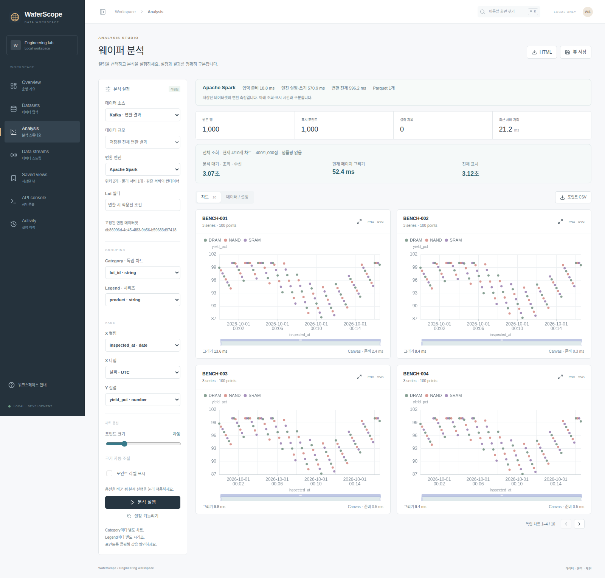
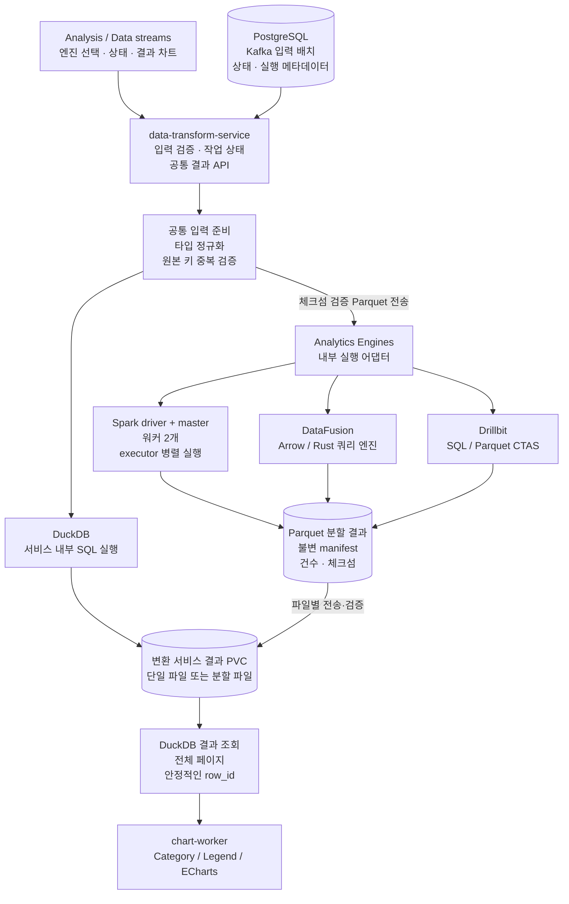

# 분석 엔진 — 현재 Engine Benchmark와 기존 스트림 경로

2026-11-13 구현. **네 엔진이 실제로 SQL 변환을 실행**합니다. 엔진 이름만 바꾸거나 실패한 작업을 DuckDB로 대신 실행하지 않습니다.

## 현재 화면에서 사용하기

**Engine Benchmark**에서 게시된 워크플로우와 inputs 또는 성공 실행을 선택합니다. 세 엔진이 고정 Query 결과를 입력으로 워크플로우 변환 그래프를 직접 실행합니다. 연산은 Workflows에서 정의하며 벤치마크 화면에서 별도로 구성하지 않습니다. [현재 워크플로우 벤치마크 계약](workflow-benchmark.md) · [5분 데모](portfolio-guide.md)

Drill은 같은 화면 하단의 **자체 SQL 콘솔 열기**로 접근합니다. Apache DataFusion은 자체 웹 UI가 없는 실행 엔진으로 VS에 포함합니다.

**기존 스트림 비교** 버튼과 Data streams는 Kafka 기반 대용량 변환 경로입니다. 아래 구조·측정값·이미지는 2026-11-13 당시 구현한 기존 경로의 기록이며, 현재 기본 Analysis 화면의 조작 순서가 아닙니다.



## 실행 구조



| 엔진 | 배포 / 실행 | 현재 기본 자원 |
| --- | --- | --- |
| DuckDB.NET 1.5.5 | 기존 변환 Pod 내부 | threads 2, memory_limit 768MB |
| Spark 4.2.1 | Compose master, worker 2개, gateway 안의 PySpark driver | executor당 1 core / 1536MB, 전체 2 cores |
| DataFusion 55.0.0 | Python 바인딩을 통해 실제 Rust 엔진 호출 | target partitions 2, spill pool 1GB |
| Drill 1.22.0 | 별도 Compose Drillbit, REST로 CTAS 실행 | heap 1GB, direct memory 1GB, container 2 CPUs |

현재 **물리 서버 한 대**에서 Spark worker 컨테이너 두 개가 실행됩니다. master 등록 워커와 application executor가 서로 다르며, 두 executor의 실제 작업 완료 기록을 검사했습니다. 이것은 다중 프로세스 분산 실행 검증이며 **여러 물리 머신의 성능 확장 검증은 아닙니다.** 화면에도 워커 수와 물리 서버 수를 구분합니다.

## 데이터와 결과 계약

- Kafka 발행·수신·중복 방지 계약은 유지합니다. 새 feed 설정에 `engine`을 추가했습니다. 기존 설정은 `duckdb`로 해석합니다.
- 모든 엔진은 동일한 Lot+Wafer 조인, inner/left/full, `UNION ALL` merge, 수율·심각도 AND 필터를 실행합니다. 행 샘플링이나 결과 상한으로 데이터를 생략하지 않습니다.
- 공통 입력 준비에는 DuckDB의 타입 정규화와 EDS 복합 PK/결함 PK 검증을 사용합니다. Spark/DataFusion/Drill의 **조인·머지·필터 계산 자체는 선택한 엔진이 수행**합니다.
- 원격 엔진 입력은 Zstd Parquet으로 전송합니다. SHA-256과 Parquet 메타데이터를 검증한 뒤 게시합니다. 같은 job ID에 다른 입력을 덮어쓰지 않습니다.
- Spark는 입력을 4개 파티션으로 나누고 SQL/AQE로 계산합니다. 결과를 `collect()`로 driver에 모으거나 `coalesce(1)`로 파일 하나에 합치지 않습니다. 실제 결과 파일 수는 실행 계획과 빈 결과에 따라 달라집니다.
- 결과 manifest에 파일별 건수, 누적 시작 위치, 바이트 수, SHA-256을 기록합니다. .NET 서비스가 모든 파일을 검증·저장한 다음에만 데이터셋을 `ready`로 확정합니다.
- 결과 API는 manifest의 파일 순서와 Parquet 내부 행 위치로 연속적인 `row_id`를 제공합니다. 파일 경계를 넘는 페이지에서도 누락 없이 반환합니다. 이 ID는 **해당 데이터셋 내부 커서**이며 엔진 간 행 정렬이나 ID 일치를 보장하지 않습니다.
- 엔진 간 검증은 row_id를 제외한 실제 값·건수·중복을 비교합니다. 날짜는 UTC로 반환합니다. NULL과 빈 결과도 검증했습니다.
- 결과 조회는 계속 DuckDB가 담당합니다. Spark를 고른다고 차트 페이지를 읽을 때마다 Spark 작업을 실행하지 않습니다. 실행 엔진이 내려가도 저장된 결과는 읽을 수 있습니다.

### 같은 입력 재분석

`POST /api/streams/datasets/{id}/analyze`에 `{"engine":"spark"}`를 보내면 새 datasetId를 반환합니다(202). 원래 입력의 datasetId를 `input_dataset_id`에 보관합니다. 여러 번 엔진을 바꿔도 최초 입력을 가리키며 배치를 복사하거나 다시 발행하지 않습니다. 이미 준비된 결과만 재분석할 수 있습니다.

`GET /api/streams/engines`는 엔진 연결 상태, Spark 실제 등록 워커, 배포 방식, 버전을 반환합니다. 두 API 모두 BFF 허용 경로에 등록되어 있습니다. 자유 SQL, 임의 파일 경로, 외부 호스트를 브라우저가 전달하는 기능은 제공하지 않습니다.

## 측정 범위

화면과 PostgreSQL `execution`에 다음 지표를 저장합니다.

| 값 | 의미 |
| --- | --- |
| `preparationMs` | PostgreSQL 입력 파일화, 타입·키 검증. 원격 엔진은 입력 Parquet 작성까지 |
| `engineMs` | 선택 엔진의 계산과 결과 작성. Spark 최초 실행이면 세션 기동 포함 |
| `totalMs` | 준비부터 최종 결과 파일 확보까지. 원격 전송·체크섬 검증 포함 |
| `transferAndCoordinationMs` | 원격 엔진에서 전체 시간 중 준비·계산을 제외한 구간 |
| `details.coldStart` | Spark 세션을 이번 요청에서 처음 기동했는지 |
| `details.sessionStartupMs` | Spark 세션 획득 시간. executor 준비 비용 일부는 이후 실행에 포함될 수 있음 |

Analysis에서 새 변환을 시작한 경우 `분석 대기·조회·수신`에는 발행·대기·변환·차트 조회가 포함됩니다. 저장된 결과를 다시 열면 `조회·수신`만 측정합니다. 변환 측정과 브라우저 그리기 시간을 혼동하지 않습니다.

성능 수치는 동일 호스트에서 수행한 **기능 검증 중 단일 관측값**입니다. 일부 구간에는 브라우저 검사가 함께 실행됐습니다. 엔진별 입력 형식·정렬·자원 설정도 다릅니다. 특히 DuckDB 경로는 정렬한 row_id를 물리적으로 쓰고, 원격 엔진은 manifest로 조회 커서를 만듭니다. 따라서 엔진 자체의 우열이나 다중 머신 속도 향상으로 일반화하지 않습니다.

### 원본별 100만 행 검증 중 관측

| 엔진 | 입력 준비 | 실행·쓰기 | 변환 전체 | 결과 행 |
| --- | ---: | ---: | ---: | ---: |
| duckdb | 4.10초 | 0.96초 | 5.06초 | 1,000,000 |
| spark | 4.56초 | 3.74초 | 8.39초 | 1,000,000 |
| datafusion | 4.63초 | 0.36초 | 5.06초 | 1,000,000 |
| drill | 4.52초 | 3.93초 | 8.76초 | 1,000,000 |

Spark는 기동된 세션을 재사용한 값입니다. 이 표는 원본 조회·Kafka 발행·작업 대기·차트 전송/렌더링을 포함하지 않습니다.

## 저장 위치와 복구

- Kafka 원본 배치와 작업 상태: 기존 PostgreSQL 영속 볼륨.
- 원격 엔진 입력·계산 결과·manifest·Spark event log: Compose `engine-data` named volume, 각 컨테이너 `/engine-data`.
- 조회용 확정 결과: 변환 Pod의 기존 PVC `/data/results/<datasetId>/parts/`. 기존 DuckDB 결과는 `result.parquet`.
- Gateway 재시작 후 같은 job ID와 동일 요청의 완료 manifest가 있으면 재사용합니다. 입력·출력 파일 검증이 끝나지 않은 작업은 성공으로 표시하지 않습니다.
- 엔진 장애는 해당 데이터셋의 실패로 남습니다. 입력이 완전하면 Data streams에서 재시도할 수 있습니다. 다른 엔진으로 자동 대체하지 않습니다.
- 현재 원격 작업 동시 실행은 1개이며, 한 Spark 작업 내부의 task는 두 executor가 병렬 처리합니다. job queue와 파이프라인 앞단은 자동 분산되지 않습니다.
- 결과 PVC는 kind 노드 삭제까지 보장하는 외부 스토리지가 아닙니다. 입력·원격 작업 파일·결과의 자동 보존 기간 정리는 아직 없습니다.

## 실행 / 진단

```bash
# 전체 설치에 엔진 배포도 포함됨
./scripts/up.sh

# 엔진 구성만 갱신
./scripts/deploy-engines.sh
./scripts/deploy-streaming.sh
./scripts/deploy-portal.sh

docker compose -f compose.engines.yaml ps
docker compose -f compose.engines.yaml logs --tail=100 analytics-engines
docker compose -f compose.engines.yaml logs --tail=100 spark-worker-1 spark-worker-2
docker compose -f compose.engines.yaml exec -T drill tail -100 /var/lib/drill/log/sqlline.log
```

엔진 서비스에는 호스트 공개 포트를 추가하지 않았습니다. kind와 같은 내부 Docker 네트워크를 사용합니다. 기존 앱의 인증·다중 사용자 권한 범위를 확대하지 않습니다.

Drill 공식 이미지의 JDK는 이 호스트의 cgroup v2 탐색에서 초기화 오류를 냈습니다. `-XX:-UseContainerSupport -XX:ActiveProcessorCount=2`로 해당 탐색을 우회하고 heap/direct memory와 컨테이너 자원을 명시적으로 제한했습니다. 이 설정과 최초 Spark 기동 비용도 운영 구성의 일부입니다.

### 실제 여러 머신으로 확장할 때

추가 서버 접속 정보가 아직 없으므로 원격 서버에 설치했다고 표시하지 않습니다. 다음 조건이 필요합니다.

1. master, driver, 각 worker가 서로 통신할 수 있는 사설 네트워크/VPN과 주소.
2. 모든 worker와 driver에서 동일하게 접근 가능한 입력·결과 저장소. 현재 named volume은 단일 Docker 호스트 전용이므로 그대로 다른 머신에서 사용할 수 없습니다.
3. 공유 파일 시스템으로 `/engine-data`를 동일하게 마운트하거나, S3/MinIO 경로를 사용하는 입출력 어댑터 확장.
4. master의 7077, driver의 39001/39002, worker의 RPC/블록 전송 연결과 실제 주소 광고 설정.
5. 추가 자원에 맞춘 executor 수·cores·memory·shuffle 파티션 및 `spark.cores.max` 조정.

실제 다중 호스트 구성 후에는 동일 총 자원의 비교와 머신 추가에 따른 확장 효과를 별도로 측정해야 합니다. 현재 1천/1만/10만/100만 규모 선택은 유지했고, 1천만·1억 행의 데이터 생성이나 브라우저 표시를 검증했다고 주장하지 않습니다.

## 검증 재현

```bash
./scripts/test.sh
npm test --prefix src/Portal.Web
docker compose -f compose.engines.yaml exec -T analytics-engines python -m unittest test_sql -v
python3 scripts/engines-integration.py
PLAYWRIGHT_MODULE=/tmp/dac-browser/node_modules/playwright node scripts/engines-browser.cjs
```

통합 검사는 네 엔진 × 네 규모의 모든 결과 행을 읽고, 연속 커서·각 ID·조인 키를 확인합니다. 행 값의 순서 독립 SHA-256 기반 합·제곱합과 건수를 대조하며, 기본 데이터의 1:N·미매칭 행·merge 중복·NULL·빈 입력도 검사합니다. 원본별 N행이므로 입력은 총 2N행입니다.

추가 장애 검사는 `scripts/engines-recovery.py`입니다. 앞의 통합 검사에서 만든 `artifacts/engines-integration.json`(또는 결합 보고서)의 1천 행 검증 데이터를 사용하며 Drill을 잠시 중지/재개합니다. 저장된 결과 조회, 명시적 실패, 동일 입력 재시도를 확인합니다. 개발 환경에서 실행하세요.

공개 결과: [엔진 통합 검사](evidence/engines-integration.json), [브라우저 검사](evidence/engines-browser.json), [장애 복구 검사](evidence/engines-recovery.json).

공식 문서: [Spark 클러스터](https://spark.apache.org/docs/4.2.1/cluster-overview.html), [Spark SQL 튜닝](https://spark.apache.org/docs/4.2.1/sql-performance-tuning.html), [DataFusion Python](https://datafusion.apache.org/python/), [Drill CTAS](https://drill.apache.org/docs/create-table-as-ctas/), [Drill REST API](https://drill.apache.org/docs/rest-api-introduction/).
