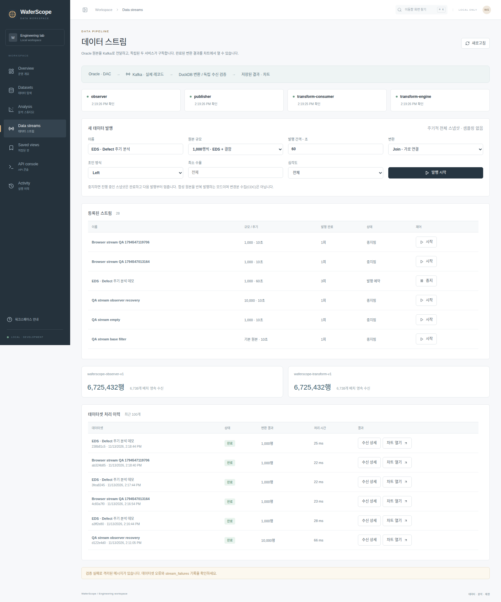
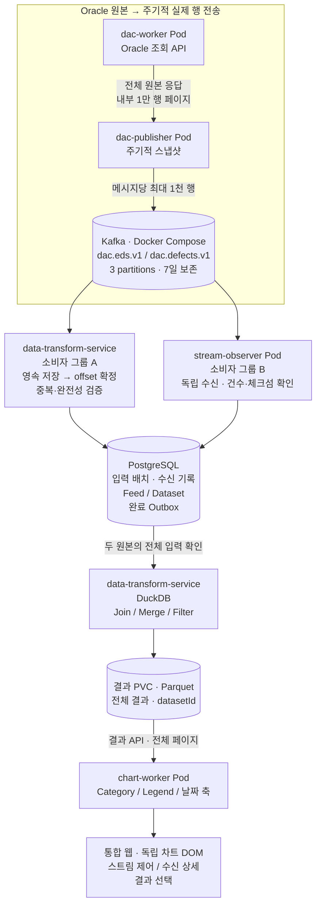

# Kafka 데이터 스트림과 분리된 변환 서비스

**분석 엔진 확장:** DuckDB·Spark·DataFusion·Drill 선택과 동일 원본 재분석을 지원합니다. 현재 구현·배포 경계는 [선택형 분석 엔진](engines.md)을 참고하세요.

2026-11-13 구현. **Kafka에는 작업 ID만이 아니라 실제 EDS·결함 행 데이터가 들어갑니다.** 두 소비자 그룹이 같은 원본을 독립적으로 읽습니다. DuckDB 계산은 DAC에서 분리한 `data-transform-service`에서 수행합니다.

## 실행과 화면

```bash
./scripts/up.sh
# 기존 설치에서 스트리밍 구성만 배포
./scripts/deploy-streaming.sh
```

통합 앱 **http://localhost:8082/#streams**에서 이름, 규모, 주기, join/merge/filter 조건을 선택하고 `발행 시작`을 누릅니다. `수신 상세`에서 소비자 그룹별 EDS/결함 예상·수신 건수를 확인하고, 완료된 데이터셋의 `차트 열기`로 분석합니다. 원본 조회와 변환을 반복하지 않고 고정된 결과를 여러 Category/Legend 설정으로 사용할 수 있습니다. 저장된 뷰와 PNG/SVG/HTML 내보내기도 datasetId를 유지합니다.

중지는 진행 중인 스냅샷을 완료한 뒤 다음 실행부터 적용됩니다. `MaxRuns`를 API에서 지정하면 해당 횟수의 성공적인 발행 후 자동으로 중지합니다. 기본값은 수동 중지 전까지 반복입니다. 주기는 이전 발행 완료 후 다음 발행까지의 대기 시간이며 여러 feed는 한 publisher가 순차 처리합니다.



검증용 QA 스트림은 중지 상태로 남아 있습니다. 화면의 격리 알림에는 통합 검사에서 의도적으로 주입한 잘못된 스키마 기록도 포함됩니다.

## 실제 구성



위 도표는 데이터 흐름입니다. UI의 발행 제어는 BFF → 변환 서비스 API → PostgreSQL 설정으로 전달됩니다. 완료 Outbox는 변환 서비스가 별도 Kafka 완료 토픽에 발행합니다.

| 구성 | 책임 |
| --- | --- |
| `Dac.Contracts` | 기존 EDS/Defect/변환 요청 계약. DB 엔진 의존성 없음 |
| `dac-worker` | Oracle 조회. DuckDB 패키지·계산 코드 제거. 기존 transform URL은 새 서비스로 전달 |
| `dac-publisher` | 별도 Pod. DAC HTTP API의 실제 행을 Kafka로 발행. PostgreSQL session advisory lock으로 단일 발행자 조정 |
| Kafka | Apache Kafka 4.1.1 KRaft 단일 브로커, Compose named volume, 호스트 포트 미공개 |
| `data-transform-service` | API + 소비자 그룹 `waferscope-transform-v1` + 계산 scheduler + 완료 Outbox 발행 |
| `stream-observer` | 별도 Pod/그룹 `waferscope-observer-v1`. 같은 데이터를 독립 수신하고 건수·체크섬·offset 기록 |
| `Streaming.Core` | 버전 있는 이벤트 계약, PostgreSQL 영속 수신, Kafka 클라이언트 설정 |
| `chart-worker` | `source=transformed`, `datasetId`를 받아 변환 결과 전체를 페이지 조회 |

observer는 변환 worker의 replica가 아닙니다. **서로 다른 consumer group**이므로 양쪽 모두 원본 전체를 받습니다. 현재 두 서비스의 예제이며 별도 비즈니스 소비자를 같은 패턴으로 추가할 수 있습니다.

## 원본 모드와 이벤트 계약

현재는 **주기적 전체 스냅샷 발행**입니다. Oracle CDC/트랜잭션 로그 구독은 구현하지 않았습니다. 기본 EDS/결함 또는 별도 benchmark 테이블에서 원본을 읽습니다. benchmark 선택 N은 EDS N행 + 결함 N행, 총 2N개의 논리적 원본 행을 뜻합니다.

| 토픽 | 데이터 |
| --- | --- |
| `dac.eds.v1` | 실제 EDS 행 배열과 데이터셋 manifest |
| `dac.defects.v1` | 실제 결함 행 배열과 manifest |
| `dac.transform.completed.v1` | datasetId, feedId, eventId, 결과 건수, 완료 시간 |

각 토픽은 3개 partition, 개발 환경 replication factor 1, 보존 기간 7일입니다. producer는 idempotence, acks=all, Zstd 압축을 사용합니다. `datasetId`를 Kafka key로 사용하여 같은 데이터셋/토픽의 순서를 유지합니다. 두 토픽 사이의 전역 순서는 가정하지 않습니다.

```json
{
  "schemaVersion": 1,
  "datasetId": "UUID",
  "feedId": "UUID",
  "source": "eds",
  "sequence": 0,
  "totalBatches": 10,
  "totalRows": 10000,
  "capturedAt": "2026-11-13T00:00:00Z",
  "rows": [
    {"lotId":"BENCH-001","waferId":"W0000001","product":"DRAM","testedDies":1000,"goodDies":989,"yieldPct":98.9,"inspectedAt":"2026-10-01T00:00:01Z"}
  ],
  "eventId": "datasetId:eds:0"
}
```

위 rows는 형식 설명을 위해 1행만 표시한 예시입니다. 실제 1만 행 입력은 배치당 1천 행, 10개 메시지입니다. 마지막 배치는 남은 행 수와 일치해야 하며 0행 원본도 명시적인 빈 manifest 배치 하나를 보냅니다. DAC는 1만 행씩 읽고 Kafka 전송 시 1천 행씩 나눕니다. 메시지 인코딩이 900KB를 넘으면 명시적으로 실패하며 큰 메시지를 조용히 자르지 않습니다.

캡처 시각은 발행 작업 식별용입니다. **두 API 호출을 Oracle의 동일 SCN으로 고정하는 보장은 없습니다.** 불변 benchmark로 전체 검증했으며, 쓰기가 동시에 발생하는 실데이터에는 SCN/버전 스냅샷 또는 CDC 경계 설계가 추가로 필요합니다.

## 저장, 완전성, 재처리

1. publisher가 PostgreSQL에 dataset을 등록하고 실제 원본을 발행합니다. 모든 발행 확인 후 `published`로 표시합니다.
2. 소비자는 schema/topic/manifest/행 필드를 검증하고 PostgreSQL에 입력을 저장합니다. 그 다음 Kafka offset을 commit합니다.
3. `(consumer_group, dataset_id, source, sequence)`가 고유 키입니다. 동일 메시지 재전달은 no-op, 같은 키의 다른 체크섬은 오류로 격리합니다.
4. 변환 그룹은 실제 행 JSONB를 보존합니다. observer는 건수·체크섬·토픽·partition·offset만 보존합니다.
5. EDS와 결함 각각 배치 수, 시작/끝 sequence, 전체 행 수가 일치하고 발행이 끝났을 때만 계산합니다.
6. DuckDB가 타입 지정 NDJSON을 테이블로 읽고 EDS 복합 PK/결함 PK를 확인합니다. 중복 원본 키는 실패합니다. 기존 행별 INSERT 경로를 대량 계산에 사용하지 않습니다.
7. join/merge/filter 전체 결과에 row_id를 부여하고 Parquet으로 씁니다. 임시 파일을 최종 파일로 교체한 뒤 완료 상태와 Outbox를 같은 PostgreSQL 트랜잭션에 저장합니다.
8. Outbox가 완료 이벤트를 Kafka에 발행하고 완료 표시를 남깁니다. 재전달 가능성이 있으므로 eventId를 유지합니다.

Kafka offset commit 직전 장애가 나도 durable 입력과 고유 키를 사용해 중복을 흡수합니다. DB 일시 오류는 해당 offset을 건너뛰지 않고 재시도합니다. 잘못된 스키마/manifest/충돌 메시지는 `stream_failures`에 영속 격리한 뒤 진행합니다. 이미 확정된 정상 결과는 뒤늦은 잘못된 재전달로 덮어쓰지 않습니다.

publisher 재시작 시 미완료 `publishing` 데이터셋은 실패로 남기고 새 데이터셋 ID로 다시 시작합니다. 불완전한 스냅샷을 성공 처리하지 않습니다. 변환 scheduler는 완전한 `published`/중단된 `processing` 데이터셋을 재개합니다. 완전한 입력이 남은 실패 작업은 `/retry`로 다시 계산할 수 있습니다.

## API

BFF `/api/execute` envelope를 통해 다음 경로를 실행합니다. 직접 서비스 주소는 클러스터 내부 `http://data-transform-service:8080`입니다.

| 메서드 / 경로 | 용도 |
| --- | --- |
| GET `/api/streams/status` | 브로커 연결, 서비스 heartbeat, 소비자 건수, 격리 건수 |
| GET/POST `/api/streams/feeds` | 등록 목록 / 발행 설정 생성 |
| POST `/api/streams/feeds/{id}/start` | 발행 재개 |
| POST `/api/streams/feeds/{id}/stop` | 현재 발행 이후 중지 |
| GET `/api/streams/datasets` | 최근 100개 데이터셋 |
| GET `/api/streams/datasets/{id}` | 상태와 소비자별 완전성 상세 |
| GET `/api/streams/datasets/{id}/rows?afterId=0&limit=10000` | 저장된 결과의 row_id 기준 페이지, 최대 1만 행 |
| POST `/api/streams/datasets/{id}/retry` | 완전한 입력을 가진 실패 변환 재시도 |
| POST `/api/transform/execute` | 기존 bounded 동기 변환 계약 |

발행 생성 본문:

```json
{"name":"EDS · Defect 분석","sampleSize":10000,"lotId":null,"intervalSeconds":60,"operation":"join","joinType":"left","minYield":null,"severity":null,"enabled":true,"maxRuns":null}
```

`sampleSize=null`은 기본 데이터, 나머지는 1000/10000/100000/1000000입니다. 기본 데이터는 이전의 1천 행 경계 검사를 유지합니다. Kafka benchmark 변환은 전체 입력을 계산하고 결과 행 수에 그 경계를 적용하지 않습니다. merge는 `UNION ALL`이므로 각 100만 입력이면 최대 200만 결과 행입니다.

변환 결과의 차트 요청:

```json
{"source":"transformed","datasetId":"완료된 UUID","category":"lot_id","legend":"product","x":"inspected_at","y":"yield_pct","xType":"date","sampleSize":null,"lotId":null}
```

기존 `/api/dac/transform`은 HTTP 호환 프록시로 유지했습니다. 기존 콘솔·API 호출은 동작하지만 계산은 별도 서비스에서 실행합니다. 기존 benchmark `source=joined` 필드 투영도 유지되며, **새 Kafka 데이터셋은 두 원본을 실제 DuckDB로 조인하는 별도 경로**입니다.

## 운영 범위

- Kafka 브로커와 publisher, 계산 scheduler는 로컬 개발 규모입니다. replication factor 1이므로 브로커 장애 시 고가용성을 제공하지 않습니다.
- 결과는 Kubernetes hostPath 기반 PVC에 저장합니다. **Pod 재시작에는 유지되지만 kind 노드/클러스터를 삭제하면 결과 파일은 사라질 수 있습니다.** 외부 객체 저장소는 아직 구현하지 않았습니다.
- 입력 배치·상태·완료 Outbox는 기존 PostgreSQL Compose 영속 볼륨에 있습니다. 브로커 로그도 별도 Compose named volume에 있습니다.
- 현재 데이터셋/입력/결과의 자동 정리 정책은 없습니다. 장시간 대규모 반복 시 디스크 사용을 확인하고 필요하지 않은 feed를 중지해야 합니다. 임의 정리는 Kafka 보존 기간·소비자 지연·저장 뷰 참조와 함께 설계해야 합니다.
- 소비자 그룹에 worker를 추가하면 partition 단위 분담이 가능하지만, 한 DuckDB 작업이 자동 분산 조인되는 것은 아닙니다. 현재 결과 PVC와 scheduler 운영은 단일 노드 기준입니다.
- Kafka 재수신은 보존된 로그 범위 안에서 가능합니다. 전체 파이프라인에 대한 exactly-once 또는 Oracle 원본의 트랜잭션 snapshot 일관성을 주장하지 않습니다.

## 검증

```bash
./scripts/test.sh
npm test --prefix src/Portal.Web
python3 scripts/streaming-integration.py
PLAYWRIGHT_MODULE=/tmp/dac-browser/node_modules/playwright node scripts/streaming-browser.cjs
```

통합 스크립트는 실제 Kafka에 데이터를 발행하며, observer를 잠시 중지/재개하고 transform Pod를 재시작합니다. 중복 메시지와 잘못된 스키마도 주입합니다. 따라서 개발 환경에서 실행하세요. 자신이 만든 feed는 maxRuns 또는 중지로 더 이상 발행하지 않도록 처리합니다. 실행 이력과 검증용 격리 기록은 증거로 남습니다.

측정의 `readyMs`는 데이터셋 등록부터 저장 결과 준비까지, `transformMs`는 PG 입력 파일화 + DuckDB + Parquet 작성 구간, `elapsedMs`는 테스트의 폴링 및 **전체 결과 재조회·ID 전수 검증**까지 포함합니다. 서로 다른 범위의 시간을 동일 지표로 비교하지 않습니다.

2026-11-13 로컬 개발 머신에서 한 번 측정한 결과입니다. N은 각 원본의 행 수이므로 Kafka의 논리적 원본 행은 2N입니다. SLA나 동시 부하 성능이 아닙니다.

| 원본별 규모 | 결과 행 | 발행 완료 | 결과 준비 전체 | 입력 파일화·DuckDB·Parquet |
| --- | ---: | ---: | ---: | ---: |
| 1천 | 1,000 | 99.4ms | 403.6ms | 52.0ms |
| 1만 | 10,000 | 367.9ms | 1.39초 | 78.6ms |
| 10만 | 100,000 | 3.86초 | 4.52초 | 495.0ms |
| 100만 | 1,000,000 | 54.19초 | 58.28초 | 3.56초 |

100만 규모는 두 원본 총 200만 행을 실제 Kafka로 전달했습니다. 결과 100만 행의 모든 row_id, wafer_id, defect_id, lot_id를 재조회하여 확인했습니다. 재조회·검증까지 포함한 시간은 66.56초입니다. 두 소비자 그룹 모두 각각 200만 원본 행을 수신했습니다. Kafka 통합 13항목과 브라우저 9항목을 통과했습니다.

저장된 100만 행 조인 결과를 샘플링 없이 한 차트에 표시하는 추가 브라우저 검사도 3항목 통과했습니다. 조회·수신 9.19초 + Canvas 그리기 637.1ms = 전체 표시 9.83초였습니다. 위 Kafka 발행·변환 시간과는 별도 요청의 측정입니다. 기존 직접 조회 경로와 통제된 비교 실험은 아닙니다. 재현 명령은 `TRANSFORMED_DATASET_ID=<완료된 100만 행 datasetId> PLAYWRIGHT_MODULE=<playwright 경로> node scripts/chart-million-single.cjs`입니다.

원본 결과: `artifacts/streaming-integration.json`, `artifacts/streaming-browser.json`. 공개 선별 결과는 [evidence](evidence)에 보관합니다.

참고: [Kafka Docker 구성](https://kafka.apache.org/44/getting-started/docker/), [Confluent .NET producer/consumer](https://docs.confluent.io/kafka-clients/dotnet/current/overview.html), [DuckDB.NET](https://duckdb.net/docs/basic-usage.html).
