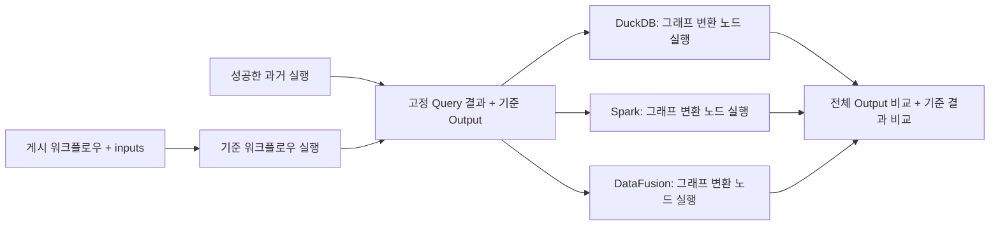

# Engine Benchmark — 워크플로우 실행 비교

2026-11-16. 메뉴의 Engine VS를 **Engine Benchmark**로 변경했습니다. 벤치마크 화면에서 Join/Merge/Filter 조건을 따로 만들지 않습니다. **Workflows에서 정의·게시한 그래프**가 비교할 작업입니다.

## 사용 순서

1. Engine Benchmark에서 워크플로우와 게시 버전을 선택합니다.
2. 실행 inputs를 편집해 새로 실행하거나, 게시 버전의 성공한 실행 기록을 선택합니다.
3. **워크플로우 벤치마크 실행**을 누릅니다.
4. DuckDB·Spark·DataFusion의 시간, 노드별 결과 건수, Output 일치 여부를 확인합니다.
5. 실행 기록을 다시 열거나 비교 CSV를 다운로드합니다. Workflows 목록과 성공 실행에서도 벤치마크로 이동할 수 있습니다.

초안은 비교 대상이 아닙니다. 과거 실행을 선택하면 그 실행의 정의·버전·입력·Query 결과를 사용합니다. 최신 초안이나 최신 API 결과로 바꾸지 않습니다.

## 실제 실행 방식

새 실행은 기존 워크플로우 실행기를 통해 API 조회·API 간 입력 연결·전체 그래프를 한 번 실행합니다. 성공하면 Query 노드의 결과와 기준 Output을 캡처합니다. 각 엔진은 같은 Query 결과에서 출발해 그래프의 Join·Filter·Merge를 위상 순서대로 직접 실행합니다. 각 노드는 **해당 엔진이 계산한 상위 노드 결과**를 읽습니다. 원래 워크플로우의 변환 결과를 엔진 결과로 대신 표시하지 않습니다.

지원하는 워크플로우 연산은 복합 키 inner/left/full Join, 이름을 맞추는 UNION ALL Merge, 여러 AND 조건 및 contains/NULL 필터, Output입니다. Query 결과는 고정 입력으로 표시하고 Output은 최종 결과를 전달합니다. Query→Output만 있는 그래프는 각 엔진에서 입력 조회를 실행해 측정합니다.

## 시간·일치 판정

- 기준 실행 노드 시간 합계: 원래 워크플로우에서 API 조회와 변환을 수행한 기록입니다. 과거 실행을 선택하면 당시 값입니다.
- 입력 준비: 각 변환 노드의 Parquet 입력 생성 시간 합계입니다.
- 엔진 계산: 각 노드의 세션/테이블 준비, 쿼리, 결과 수집 시간 합계입니다.
- 합계: 입력 준비 + 엔진 계산입니다. 큐 대기, 기준 실행과 HTTP 전송은 제외합니다.
- 노드마다 결과를 수집·다시 입력하는 방식입니다. 그래프 전체를 하나의 SQL로 최적화한 비교가 아닙니다. 엔진 세션 비용도 포함되므로 작은 입력의 시간 순위를 일반적인 성능 우열로 해석하지 않습니다.
- 세 엔진의 전체 Output을 비교하고, 원래 워크플로우 Output과도 비교합니다. 숫자는 소수 6자리 HALF_EVEN 반올림으로 정규화합니다. 행 순서는 무시하고 중복은 보존합니다. 화면 미리보기는 20행입니다.
- 엔진 순서는 실행 ID에 따라 바뀌며 순차 실행됩니다. Spark는 동일 물리 서버의 워커 2개입니다.

## 저장·제한

작업은 PostgreSQL에 접수되므로 화면을 닫아도 기준 실행과 벤치마크가 계속됩니다. 비교 기록에는 정의·버전·inputs·기준 실행 ID·입력 캡처·결과 해시·노드별 시간과 상태를 보관합니다. 실패한 엔진을 다른 엔진으로 대체하지 않습니다. 서버가 재시작되면 실행 중 비교는 interrupted로 남으며 다시 실행해야 합니다.

노드당 최대 1만 행/8MB이며 비교에 보내는 Query 결과와 기준 Output의 합계는 19MB까지입니다. DAC 쿼리의 별도 1천 행 제한도 유지됩니다. 소수점 10자리를 넘는 입력 정밀도를 조용히 잘라내지 않습니다. 역슬래시/NUL 문자열 필터는 엔진 간 문자열 처리 차이 때문에 거부합니다.

기존 소스 단위 비교 API와 대용량 스트림 경로는 호환용으로 남습니다. 기본 화면에서는 **워크플로우 실행**만 선택합니다. Drill은 자체 SQL 콘솔 링크를 사용합니다.

## API와 검증

`POST /api/workflow-benchmarks`

- 새 준비 실행: `{"workflowId":"UUID","version":1,"inputs":{"lot_id":"LOT-101"}}`
- 기존 성공 실행 재사용: `{"runId":"UUID"}`
- 응답: HTTP 202 `{ "id": "벤치마크 UUID" }`
- 상태/결과: `GET /api/source-comparisons/{id}`

조회 응답은 입력 행 전체를 포함하지 않습니다. 보관된 입력은 서버에서 엔진 재실행에만 사용합니다.

`python3 scripts/workflow-benchmark-integration.py`는 실제 Oracle와 세 엔진으로 전체 그래프, AND/contains 필터, Merge 중복, 기준 결과 일치, 게시 정의 저장과 이력 재사용을 확인합니다. `scripts/workflow-benchmark-browser.cjs`는 워크플로우 선택, 재접속, 노드 결과, CSV, 실행 링크, 모바일을 검증합니다. Python `test_workflow_benchmark.py`는 하위 노드가 실제 상위 계산 결과를 쓰는지, 빈 입력, 순환 그래프 거부, 조인 별칭 타입을 검사합니다.
