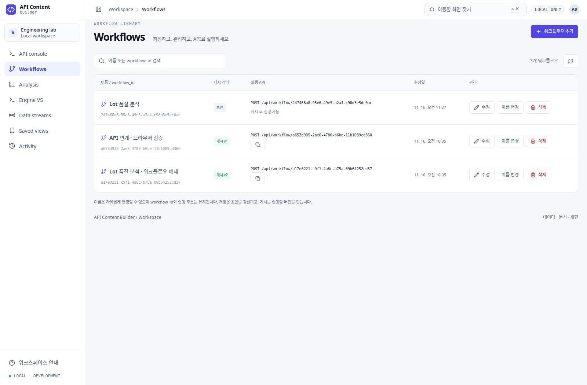
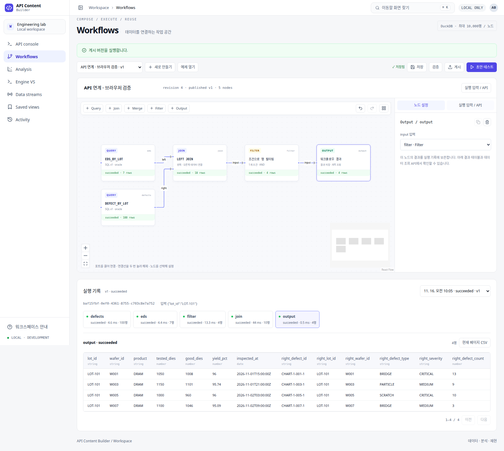

# 저장 쿼리 워크플로우

API Content Builder의 **Workflows**는 목록부터 열립니다. 목록에서 추가·수정·이름 변경·삭제·검색을 제공합니다. 추가할 때 이름과 시작 방법(빈 워크플로우/예제)을 선택한 뒤 편집기로 들어갑니다. 편집기에서도 이름을 변경하고 저장할 수 있습니다. 이름을 바꿔도 workflow_id(UUID)와 실행 주소는 유지됩니다.

편집기에서 Query → Join / Merge → Filter → Output 그래프를 편집하고 PostgreSQL에 저장합니다. 편집 초안과 게시 버전은 별개이며 게시 버전은 변경되지 않습니다. React Flow는 편집 UI만 담당하며 실행은 .NET 백그라운드 서비스, 데이터 변환은 DuckDB가 수행합니다.





## 사용 순서

1. API 콘솔에서 query_id와 바디를 고른 뒤 **워크플로우로 연결**을 누르거나 Workflows에서 **워크플로우 추가**를 누르고 이름을 입력한 뒤 예제를 선택합니다. 콘솔 요청으로 시작할 때도 이름을 입력한 후 생성합니다.
2. 쿼리 노드에서 기본 바디, 최근 실행 히스토리, 직접 입력 중 원하는 방법을 사용합니다. 이력의 바디는 복사되며 이력 ID는 출처로만 보존됩니다. 이력 선택은 과거 데이터를 복원하는 동작이 아닙니다.
3. 노드 오른쪽 포트에서 다음 노드의 왼쪽 포트로 드래그합니다. 설정 패널의 입력 목록으로도 연결할 수 있습니다. Join/Merge는 left와 right, Query의 API 의존성은 after, Filter/Output은 input 포트를 사용합니다.
4. **실행 입력 / API**에서 기본 입력과 이번 실행 입력을 설정합니다. 기본 입력은 정의에 저장되고 이번 실행 입력은 해당 실행에만 사용됩니다.
5. **검증**은 그래프·순환·포트·참조·설정을 검사합니다. 실제 컬럼·타입·쿼리 존재 여부는 실행 시 검사합니다.
6. **초안 테스트**는 현재 초안을 저장한 뒤 서버에서 실행합니다. 노드를 선택하면 시간, 스키마, 실제 요청, 데이터 페이지를 볼 수 있습니다.
7. **게시**하면 새 버전이 만들어집니다. 게시 API는 기본적으로 최신 게시 버전을, version을 지정하면 해당 버전을 실행합니다. 게시 후 초안 수정은 게시된 동작에 영향을 주지 않습니다.

편집 변경은 브라우저에 임시 저장합니다. **저장**을 눌러야 서버에 보관됩니다. 저장 충돌은 409이며 저장된 워크플로우를 다시 선택해 서버 버전을 불러올 수 있습니다. 노드 복제·삭제·실행 취소·다시 실행·자동 정렬을 지원합니다.

## 값 연결

값을 문자열로 치환하지 않고 JSON 객체로 참조해 숫자·문자열·null 타입을 유지합니다.

```json
{
  "database_name": "oracle",
  "query_id": "EDS_BY_LOT",
  "lot_id": { "$input": "lot_id" },
  "min_yield": 90,
  "limit": 100
}
```

앞 API의 특정 행을 사용하는 경우 해당 노드를 after 포트에 연결합니다.

```json
{ "lot_id": { "$node": "eds", "column": "lot_id", "row": 0 } }
```

row는 0부터 시작합니다. 행이 없거나 컬럼이 없으면 실패하며 임의의 기본값으로 대체하지 않습니다. 등록된 DAC 조회 API 간 연결을 지원하며 임의 URL 호출, 배열별 반복 호출, 조건 분기, 스케줄은 이번 버전에 포함하지 않습니다.

## 변환 의미

- **Join**: INNER / LEFT / FULL, 복합 키, 같은 타입끼리 비교. null 키는 매칭하지 않습니다. 오른쪽 컬럼에는 `right_` 접두사가 붙고 충돌하면 접두사를 추가합니다. 중복 키는 SQL의 다대다 행 확장 규칙을 따릅니다.
- **Merge**: `UNION ALL BY NAME`. 컬럼 이름으로 정렬하고 없는 값은 null, 중복은 유지합니다. 같은 이름의 타입이 다르면 실패합니다. DB upsert 의미의 MERGE가 아닙니다.
- **Filter**: 여러 조건의 AND. eq/ne/gt/gte/lt/lte/contains/isNull/notNull. 값 타입을 검사하고 바인딩 파라미터를 사용합니다. null에는 전용 연산자를 사용합니다.
- **Output**: 정확히 하나. 모든 노드는 Output까지 연결되어야 합니다. 결과를 JSONB 스냅샷으로 저장하고 페이징으로 조회합니다. CSV는 현재 페이지를 내보냅니다.

Oracle 결과는 빈 배열이어도 컬럼 메타데이터를 제공합니다. 날짜는 UTC ISO 문자열과 `date` 타입으로 유지합니다. 워크플로우의 숫자 처리는 DuckDB DECIMAL(38,10)을 사용하며 소수점 10자리를 넘는 값은 조용히 반올림하지 않고 거부합니다.

## API

```http
POST /api/workflow/{workflow_id}
Content-Type: application/json

{"version":1,"inputs":{"lot_id":"LOT-101"}}
```

`202 Accepted`와 `{"runId":"..."}`, 상태 조회 Location을 반환합니다.

| API | 의미 |
| --- | --- |
| GET /api/workflows | 워크플로우 목록 |
| POST /api/workflows | name, definition으로 초안 생성 |
| GET /api/workflows/{id} | 초안과 revision, published_version |
| PUT /api/workflows/{id} | name, definition, revision으로 충돌 검사 후 갱신 |
| POST /api/workflows/validate | definition 구조 검증 |
| POST /api/workflows/{id}/publish | `{ "revision": n }`으로 불변 버전 생성 |
| GET /api/workflows/{id}/versions | 게시 이력 |
| POST /api/workflows/{id}/test | 저장된 초안 스냅샷 실행 |
| POST /api/workflow/{id} | 게시 버전 실행 (권장 주소) |
| POST /api/workflows/{id}/runs | 같은 실행 기능의 기존 호환 주소 |
| DELETE /api/workflows/{id}?revision=n | 실행 중 작업과 revision을 검사한 뒤 논리 삭제 |
| GET /api/workflows/{id}/runs | 최근 실행 50건 |
| GET /api/workflow-runs/{runId} | 상태, 입력, 노드 시간·요청·버전·10행 미리보기 |
| POST /api/workflow-runs/{runId}/cancel | 대기/진행 실행 취소 요청 |
| GET /api/workflow-runs/{runId}/nodes/{nodeId}/data?offset=0&limit=100 | 결과와 스키마; 페이지 최대 1,000행 |

같은 workflow ID와 version을 호출해도 Oracle의 현재 데이터가 조회됩니다. 실행마다 정의·입력·노드 결과는 보존됩니다. SQL 자체는 이 서비스에서 아카이브하지 않으므로 카탈로그의 query_version이 달라지면 실행을 중단합니다. SQL을 변경하는 관리자는 반드시 query_version을 증가시켜야 합니다.

## 실행과 운영 범위

- 현재 포털 파드 내 `WorkflowRunner`가 PostgreSQL 대기열을 처리합니다. DB advisory lock으로 하나의 실행 서비스만 동작하며 한 번에 한 실행을 처리합니다. 독립 노드도 순차 실행합니다.
- 브라우저 연결과 분리된 실행입니다. 화면을 닫아도 계속되며 취소는 상태가 cancelled로 바뀌었는지 확인해야 합니다.
- 서비스 재시작 시 진행 중 작업은 interrupted, 대기 작업은 유지합니다. 중간 API 호출을 자동 반복하지 않으며 사용자가 새 실행으로 재시도합니다. 실패한 노드 뒤의 대기 노드는 skipped입니다.
- 최대 30노드, 100연결, 대기+진행 20실행. 전체 3분, 쿼리 노드 40초, DuckDB 명령 30초, 메모리 설정 256MB, 임시 디스크 spill 비활성화.
- 노드 결과 최대 10,000행 / 8MB. 초과 시 잘라서 성공시키지 않고 명시적으로 실패합니다. 기존 Analysis의 100만 행 처리와는 별개입니다.
- 결과 스냅샷은 PostgreSQL JSONB에 저장합니다. 자동 보존 기간·삭제 정책, 대용량 Parquet 데이터셋 참조, 실패 지점 재개, 인증·권한은 아직 제공하지 않습니다. 기존 로컬 단일 워크스페이스 범위입니다.

## 검증

- `./scripts/test.sh`: 그래프 검증, 참조 타입, null·다대다 조인, 머지 타입 충돌, 빈 스키마, 주입 문자열, 행 확장 한도, 취소 등 .NET 테스트.
- `npm test --prefix src/Portal.Web`: 연결 가능 여부와 순환 방지·자동 정렬 테스트.
- `python3 scripts/workflow-integration.py`: 실제 Oracle/DuckDB/PostgreSQL, 독립 계산 결과 비교, 버전 불변성, 실패·취소 검증. 검증용 워크플로우와 이력을 생성합니다.
- `PLAYWRIGHT_MODULE=/tmp/dac-browser/node_modules/playwright node scripts/workflow-browser.cjs`: 노드 연결, 이력 복사, 잘못된 JSON, 편집·실행·게시·다시 열기·모바일·콘솔 연계 검증.

삭제는 논리 삭제입니다. 목록과 편집 API에서 사라지고 두 실행 주소 모두 404를 반환하지만 과거 실행 기록은 보존합니다. 대기·실행 중이면 409로 삭제를 거부합니다. 게시된 API는 계속 202 + runId를 반환하는 비동기 실행이며, 결과는 실행 상태/노드 데이터 API로 조회합니다.
